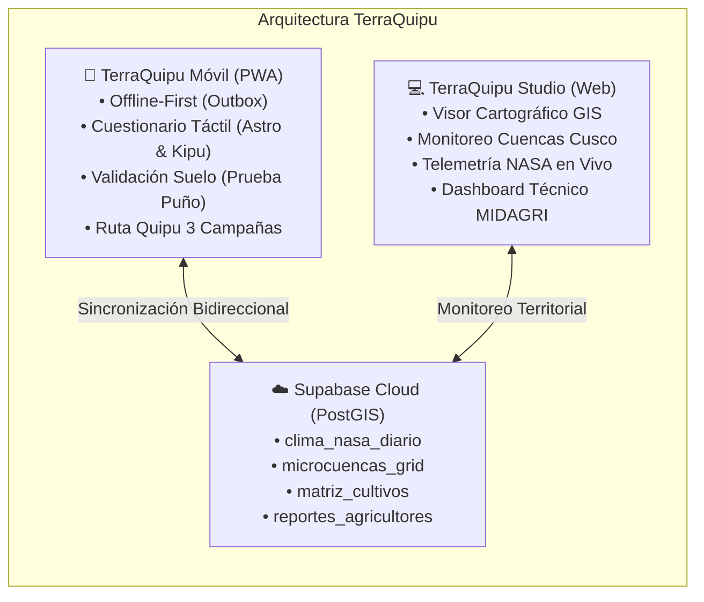
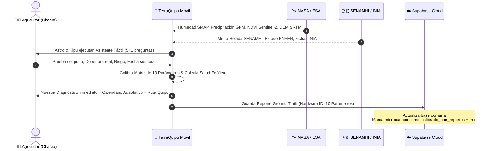
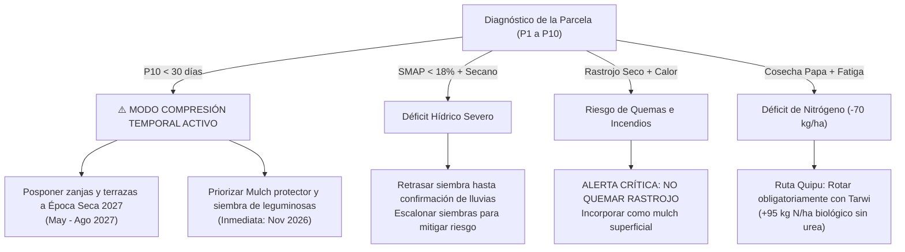
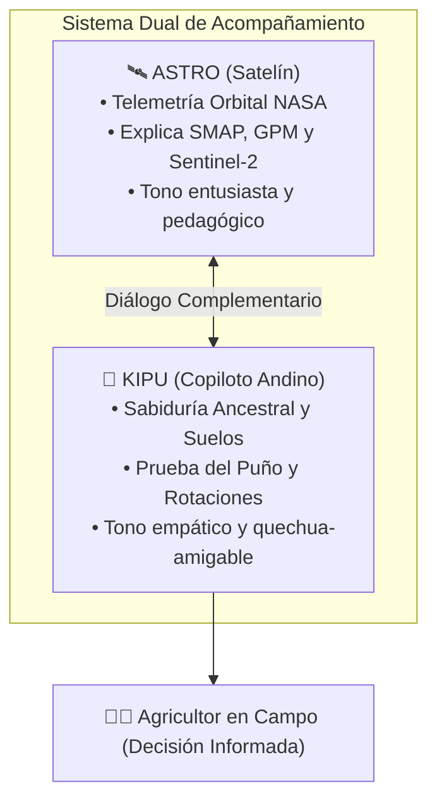

# NASA SPACE APPS CHALLENGE · DOCUMENTACIÓN DE ARQUITECTURA Y DISEÑO
# INFORME DE DISEÑO E INGENIERÍA: TERRAQUIPU

**Sistema de Apoyo a la Toma de Decisiones y Calibración Ground-Truth para la Conservación de Suelos Agrícolas frente a El Niño (2026–2027) en la Sierra de Cusco**

* **Proyecto:** Ecosistema TerraQuipu (PWA Móvil Offline-First + Web Studio Geoespacial + Motor de Triangulación Satelital)
* **Ámbito Piloto:** Sierra de Cusco, Perú (Microcuencas Piuray–Ccorimarca y Vilcanota–Urubamba)
* **Desafío:** NASA Space Apps Challenge — Monitoreo, Conservación de Suelos y Resiliencia Climática

---

## ÍNDICE DE CONTENIDOS

1. [Resumen Ejecutivo y Objetivo del Proyecto](#1-resumen-ejecutivo-y-objetivo-del-proyecto)
2. [Diagnóstico de Situación: Punto de Partida vs. Visión Objetivo](#2-diagnóstico-de-situación-punto-de-partida-vs-visión-objetivo)
   * 2.1. Arquitectura del Ecosistema TerraQuipu (Móvil PWA + Web Studio + Cloud)
   * 2.2. Contexto Climático Crítico: El Niño 2026–2027 en la Sierra de Cusco
3. [Arquitectura de Fusión de Datos en Tres Niveles y Feedback Loop](#3-arquitectura-de-fusión-de-datos-en-tres-niveles-y-feedback-loop)
   * 3.1. Nivel 1: Observación Satelital Orbital (NASA / ESA)
   * 3.2. Nivel 2: Fuentes Institucionales Oficiales (Perú)
   * 3.3. Nivel 3: Sensoramiento Participativo Ground-Truth (Agricultor Andino)
   * 3.4. Ciclo de Retroalimentación Abierta (Supabase Cloud & Outbox Offline)
4. [Modelo de Diagnóstico: Los 10 Parámetros Maestros y Matriz de Contraste](#4-modelo-de-diagnóstico-los-10-parámetros-maestros-y-matriz-de-contraste)
   * 4.1. Criterios de Agrupación y Jerarquía de Cálculo (White-Box)
   * 4.2. Matriz de Contraste de los 10 Parámetros (Satélite vs. Perú vs. Campo)
   * 4.3. Algoritmo de Cálculo del Índice de Salud Edáfica y Resiliencia (0–100)
5. [Matriz Maestra de Decisión y Generación del Calendario Adaptativo](#5-matriz-maestra-de-decisión-y-generación-del-calendario-adaptativo)
   * 5.1. Matriz de Cruce (Diagnóstico $\rightarrow$ Estrategia $\rightarrow$ Ventana Temporal)
   * 5.2. Justificación Técnica y Agronómica de las Reglas Clave
6. [Diseño UX/UI Inclusivo, Ergonomía Móvil y Narrativa Dual](#6-diseño-uxui-inclusivo-ergonomía-móvil-y-narrativa-dual)
   * 6.1. Sistema Dual de Copilotos: Kipu (Suelo Andino) y Astro-Satelín (NASA)
   * 6.2. Principios de Ergonomía Táctil y Accesibilidad (Web Audio API)
7. [Hoja de Ruta de Implementación y Estado de Avance](#7-hoja-de-ruta-de-implementación-y-estado-de-avance)
8. [Rigor Científico, Transparencia e Incertidumbre](#8-rigor-científico-transparencia-e-incertidumbre)

---

## 1. Resumen Ejecutivo y Objetivo del Proyecto

### Objetivo General
Desarrollar un ecosistema integrado de acompañamiento agronómico, teledetección espacial y apoyo a la toma de decisiones (**TerraQuipu**) que fusione observaciones satelitales de la NASA y la ESA con información climática oficial de instituciones peruanas (SENAMHI, ENFEN, INIA, ZEE) y la verificación táctil *in-situ* de campesinos andinos. El sistema estima el riesgo de degradación del suelo asociado al evento El Niño 2026–2027, calcula un **Índice de Salud Edáfica y Resiliencia (0 a 100)** y genera un calendario dinámico de intervención para preservar la capa arable en microcuencas vulnerables de Cusco.

### Diferenciadores Clave para la Evaluación NASA Space Apps
1. **Compresión Temporal Dinámica:** A diferencia de calendarios agrícolas estáticos, el motor reconoce que El Niño 2026–2027 ya está activo. Recomendar obras civiles pesadas (zanjas de infiltración o andenería) a pocas semanas de sembrar es inviable y remueve suelo seco vulnerable. El sistema comprime el cronograma: pospone obras físicas pesadas a la época seca de 2027 y concentra la campaña inmediata en **manejo biológico de cobertura, retención de humedad y rotación con leguminosas (tarwi/haba)**.
2. **Triangulación y Calibración Ground-Truth:** Resuelve el histórico error de escala de los satélites en topografía andina compleja. La teledetección macro (SMAP ~9–36 km, GPM ~10 km) es calibrada por la prueba táctil del puño y la inspección de rastrojos del propio agricultor.
3. **Crowdsourcing Comunal Abierto:** El agricultor no solo consume datos; su validación retroalimenta una base de datos territorial abierta en Supabase, construyendo un mapa en tiempo real de focos de sequía, erosión y plagas para toda la comunidad.
4. **Resiliencia Operativa Offline-First:** Diseñado para funcionar en quebradas sin cobertura celular mediante colas de sincronización local (Outbox) y huellas de hardware determinísticas.

---

## 2. Diagnóstico de Situación: Punto de Partida vs. Visión Objetivo

### 2.1. Arquitectura del Ecosistema TerraQuipu
La solución no se limita a un portal web estático, sino que opera como un ecosistema modular de 3 componentes:

1. **TerraQuipu Móvil PWA (`terraquipu-app`):** Aplicación web progresiva móvil orientada al productor campesino. Prioriza usabilidad con una mano, tipografías de alto contraste, retroalimentación táctil con sonidos sintetizados (Web Audio API) y operatividad sin conexión a internet.
2. **TerraQuipu Studio / Visor Técnico (`terraquipu-web` / `terraquipu-suite`):** Plataforma web de escritorio para especialistas agrarios del MIDAGRI, técnicos municipales y directores de comunidades campesinas. Provee visualización de capas cartográficas GIS (Leaflet/Mapbox), polígonos de parcelas y series temporales climáticas.
3. **Backend & Base de Datos Espacial (Supabase + Python API):** Base de datos relacional con extensiones espaciales (PostgreSQL + PostGIS). Aloja las tablas maestras `microcuencas_grid`, `matriz_cultivos`, `clima_nasa_diario` y el repositorio colaborativo `reportes_agricultores`.

### 2.2. Contexto Climático Crítico: El Niño 2026–2027 en Cusco
* **Alerta Oficial ENFEN:** Se mantiene activo el estado de alerta por El Niño Costero y condiciones cálidas en el Pacífico Central (Niño 3.4), proyectando impactos estacionales severos hasta inicios de 2027.
* **Pronóstico SENAMHI para la Sierra Sur:** Escenario caracterizado por marcada irregularidad de precipitaciones (déficit de hasta -35% en acumulados mensuales), anomalías térmicas positivas ($+1.5^\circ\text{C}$ a $+2.5^\circ\text{C}$) y tormentas convectivas aisladas pero erosivas.
* **Vulnerabilidad Agrícola en Cusco:** El 68% de la superficie cultivable en Cusco depende exclusivamente de las lluvias (agricultura de secano), y 95 distritos se encuentran en riesgo alto o muy alto de estrés hídrico.
* **Mecanismos de Degradación del Suelo:**
  1. *Desecación y Erosión Eólica:* Las altas temperaturas y la falta de lluvias resecan la capa arable; las quemas de pastizales destruyen la materia orgánica superficial.
  2. *Erosión Hídrica por Tormentas Convectivas:* Lluvias torrenciales sobre suelos desprovistos de cobertura o con pendiente pronunciada arrastran toneladas de sedimentos y nutrientes hacia los cauces.
* **Microcuencas Piloto Seleccionadas:**
  * **Microcuenca Vilcanota – Urubamba (Maras / Chinchero / Piuray, 3380–3800 msnm):** Zona de alta producción de papa nativa y maíz blanco, con presencia de lagunas estratégicas y parcelas en ladera.
  * **Pampa de Anta – Huarocondo (3450 msnm):** Zona de transición cerealera y leguminosa con suelos de textura franca a arcillosa.
  * **Altiplano Norte – Melgar / Ayaviri (3910 msnm):** Zona extrema de puna expuesta a heladas agronómicas severas y sequía forrajera.

---

## 3. Arquitectura de Fusión de Datos en Tres Niveles y Feedback Loop

### 3.1. Nivel 1: Observación Satelital Orbital (NASA / ESA)
Proporciona la línea base biofísica continua y multiespectral sobre las microcuencas:
* **NASA SMAP (Soil Moisture Active Passive):** Humedad volumétrica del suelo en los primeros 5 cm ($m^3/m^3$) mediante radiometría en Banda L (1.4 GHz), inmune a la nubosidad andina, con frecuencia de retorno de 2 a 3 días.
* **NASA GPM / IMERG (Global Precipitation Measurement):** Precipitación líquida acumulada diaria y horaria (mm) con resolución de 0.1° (~10 km) para cuantificar anomalías hídricas.
* **Copernicus Sentinel-2 (ESA) + Landsat (NASA):** Reflectancia multiespectral a 10 m – 30 m para derivar el Índice de Vegetación de Diferencia Normalizada (NDVI), el Índice de Suelo Desnudo (BSI) y el Índice de Labranza y Rastrojo (NDTI).
* **NASA SRTM DEM (Shuttle Radar Topography Mission):** Modelo digital de elevación de 30 m de resolución para cálculo de pendientes topográficas (%), orientación de ladera y escorrentía.
* **NASA ECOSTRESS + NASA POWER / ERA5:** Temperatura de la superficie terrestre (LST), evapotranspiración real del cultivo (ET) y series agroclimáticas horarias (radiación solar y temperatura mínima nocturna).

### 3.2. Nivel 2: Fuentes Institucionales Oficiales (Perú)
Aterriza la telemetría espacial en el marco regulatorio, agronómico y climático local:
* **SENAMHI:** Red oficial de estaciones meteorológicas automáticas y convencionales en Cusco (Pisac, Kayra, Anta, Urubamba), avisos meteorológicos de heladas y boletín de balance hídrico agrícola.
* **ENFEN (Comité Multisectorial ENOS):** Comunicados oficiales mensuales de la probabilidad, fase y magnitud de El Niño y La Niña en las regiones Niño 1+2 y Niño 3.4.
* **INIA (Estación Experimental Agraria Andenes – Cusco):** Parámetros edáficos de variedades andinas nativas, requerimientos nutricionales de extracción de nitrógeno (papa nativa: $-70\text{ kg N/ha}$) y fijación biológica de leguminosas (haba verde: $+75\text{ kg N/ha}$, tarwi: $+95\text{ kg N/ha}$).
* **CIP (Centro Internacional de la Papa) & SENASA:** Modelos de fenología de plagas de altura, alerta de eclosión del gorgojo de los Andes (*Premnotrypes spp.*) y condiciones predisponentes de tizón tardío/rancha (*Phytophthora infestans*).
* **Programa Sierra Azul / ANA:** Inventario de infraestructura natural (qochas, zanjas de infiltración y padrones de riego comunal).

### 3.3. Nivel 3: Sensoramiento Participativo Ground-Truth (Agricultor Andino)
El campesino ejecuta una calibración táctil mediante 5 preguntas estructuradas obligatorias y 1 de historial agronómico, completadas en menos de 40 segundos:

| # | Pregunta Cerrada en la Interfaz | Opciones Táctiles de Respuesta | Parámetro Técnico que Calibra |
|---|---|---|---|
| **Q1** | **¿Cómo siente su tierra al pisar o apretarla húmeda?** | 🔘 Seca y polvo  🔘 Húmeda y mullida (bola suave)  🔘 Encharcada / barro pegajoso | **Textura y Humedad Edáfica:** Calibra SMAP y SoilGrids con la prueba ancestral del puño (*allpa t'ikay*). |
| **Q2** | **¿Cuántas piedras afloran en su tierra o qué tan profunda es?** | 🔘 Poco profunda / muy pedregosa  🔘 Suelo profundo y limpio | **Profundidad Efectiva y Pedregosidad:** Filtra si el terreno tolera excavación de zanjas o requiere cobertura biológica. |
| **Q3** | **El satélite observa su chacra hoy. ¿Cómo está realmente el lote?** | 🔘 Cultivo verde creciendo  🔘 Rastrojo o barbecho de descanso  🔘 Pasto natural  🔘 Tierra pelada (suelo desnudo) | **Cobertura Real del Suelo:** Discrimina suelo expuesto a erosión violenta vs. suelo protegido por mantillo vegetal. |
| **Q4** | **¿Cómo riega o abastece de agua esta parcela?** | 🔘 Solo lluvia (secano estricto)  🔘 Lluvia con canal de auxilio comunal  🔘 Riego permanente / tecnificado | **Disponibilidad Hídrica Real:** Modula el factor de estrés por sequía en la matriz de decisión. |
| **Q5** | **Frente a la alerta de El Niño, ¿cuándo piensa sembrar?** | 🔘 Esta semana  🔘 En 2 a 4 semanas  🔘 En 1 a 2 meses  🔘 Próxima campaña (terreno en descanso) | **Ventana de Compresión Temporal:** Dispara la postergación de obras físicas si la siembra es inminente ($<30\text{ días}$). |
| **Q6** | **¿Qué cultivo cosechó la campaña pasada y cuál es su prioridad?** | 🔘 Papa nativa / Maíz / Haba / Tarwi / Quinua  🔘 Prioridad: Curar tierra / Comida / Mercado | **Balance Nutricional N-P-K e Inmunidad Fitosanitaria:** Determina la Ruta Quipu de 3 campañas sucesivas. |

### 3.4. Ciclo de Retroalimentación Abierta (Supabase Cloud & Outbox Offline)
A diferencia de aplicaciones convencionales donde las respuestas se descartan tras mostrar un resultado, TerraQuipu implementa un pipeline de doble vía:
1. **Firma Única de Dispositivo:** Cada teléfono genera una huella de hardware determinística (`TQ-HW-XXXX`), garantizando trazabilidad sin exigir registros complejos a usuarios rurales.
2. **Cola de Salida Resiliente (Offline Outbox):** Si el campesino responde en su chacra sin cobertura, el reporte queda encolado localmente con sello temporal y georreferencia.
3. **Sincronización Cloud Automática:** Al detectar señal, el reporte se envía a la tabla `reportes_agricultores` en Supabase, adjuntando la matriz calibrada en formato JSON estructurado.
4. **Calibración Territorial:** El sistema actualiza el registro diario de la microcuenca en `clima_nasa_diario`, marcando `calibrado_con_reportes = true`. Esto refina los modelos climáticos de la zona con datos de verdad de terreno (*ground-truth*).

---

## 4. Modelo de Diagnóstico: Los 10 Parámetros Maestros y Matriz de Contraste

### 4.1. Criterios de Agrupación y Jerarquía de Cálculo (White-Box)
Los 10 parámetros se organizan en 3 grupos funcionales:
* **Grupo 1: Suelo y Relieve (P1 a P4 — Variables Físicas Estáticas):** Determinan las restricciones mecánicas del terreno (pendiente, profundidad y drenaje). Se evalúan primero para descartar intervenciones agronómicamente inviables.
* **Grupo 2: Clima y Agua (P5 a P7 — Variables Dinámicas):** Miden el balance hídrico actual y la amenaza meteorológica inmediata (humedad volumétrica, lluvia acumulada y anomalía ENOS).
* **Grupo 3: Cobertura y Manejo (P8 a P10 — Variables Operativas):** Determinan el estado biológico del lote (rastrojo, riesgo de incendios y requerimientos nutricionales del cultivo).

### 4.2. Matriz de Contraste de los 10 Parámetros (Satélite vs. Perú vs. Campo)

| Código | Parámetro Maestro | 🛰️ Telemetría Satelital (NASA/ESA) | 🇵🇪 Dato Institucional (Perú) | 🧑‍🌾 Verificación en Campo (Agricultor) | 🎯 Regla de Calibración / Contraste |
|:---:|---|---|---|---|---|
| **P1** | **Textura y Estructura Edáfica** | ISRIC SoilGrids (Fracción arena/limo/arcilla) | ZEE Cusco / INIA Andenes | Prueba de la bola (Se suelta / Esponjosa / Pegajosa) | La prueba táctil del agricultor corrige la resolución de 250 m de SoilGrids. Si es arcilloso, se emite alerta contra encharcamiento. |
| **P2** | **Pendiente del Terreno (%)** | NASA SRTM DEM 30m (Cálculo sobre polígono) | Mapas de pendientes de Gob. Regional Cusco | Inspección visual de andenes / gradas | Pendientes $>12\%$ sin andenes activan alerta de escorrentía crítica; pendientes $<5\%$ descartan zanjas de infiltración. |
| **P3** | **Profundidad y Pedregosidad** | SoilGrids (Capa fértil estimada en cm) | Fichas edafológicas INIA | Pregunta Q2 (Pedregoso / Profundo) | Suelo delgado con roca aflorante descarta excavaciones profundas y prioriza cobertura muerta y mulch. |
| **P4** | **Posición en Microcuenca** | NASA DEM (Acumulación de flujo hidrológico) | Inventario Sierra Azul / ANA | Ubicación en cabecera vs. fondo de valle | Parcelas en cabecera de cuenca activan lineamientos de recarga hídrica (protección de qochas circundantes). |
| **P5** | **Humedad Superficial Real** | NASA SMAP (Banda L radiométrica, % $m^3/m^3$) | SENAMHI (Balance Hídrico Cusco) | Pregunta Q1 (Seca / Mullida / Encharcada) | Si SMAP indica estrés hídrico ($<18\%$) pero el agricultor tiene suelo húmedo por riego o mulch, se calibra la capacidad de retención local. |
| **P6** | **Anomalía Climática El Niño** | NASA GPM (Precipitación) + NOAA Niño 3.4 | ENFEN (Alerta El Niño) + Avisos SENAMHI | Observación de retraso o inicio de lluvias | Activa el modo de compresión temporal y ajusta el balance hídrico proyectado para los siguientes 90 días. |
| **P7** | **Fuente y Seguridad Hídrica** | GLDAS / Evapotranspiración NASA POWER | Padrón de Juntas de Usuarios ANA | Pregunta Q4 (Secano vs. Canal de auxilio) | El secano puro frente a El Niño activo activa postergación de siembra; el canal de auxilio permite siembra escalonada. |
| **P8** | **Cobertura y Suelo Desnudo** | Sentinel-2 (NDVI 10 m y BSI Suelo Desnudo) | MIDAGRI (Superficie agrícola regional) | Pregunta Q3 (Cultivo / Rastrojo / Tierra pelada) | Diferencia suelo pelado expuesto a erosión de suelo en descanso con rastrojo protector (*mulch*), corrigiendo falsos positivos del NDVI. |
| **P9** | **Estrés Térmico e Incendios** | NASA ECOSTRESS (LST) + FIRMS (Focos calor) | SERFOR / COER Cusco (Riesgo incendios) | Práctica comunal de quema de rastrojos | Si hay focos de calor o rastrojo seco bajo alta temperatura, se dispara la alerta crítica: **PROHIBIDO QUEMAR**. |
| **P10** | **Cultivo y Compresión Temporal** | FAO GAEZ (Aptitud agroecológica) | INIA Cusco (Calendarios fenológicos) | Pregunta Q5 (Fecha) + Q6 (Cultivo previo) | Si la fecha planificada es menor a 30 días, se suprimen obras físicas pesadas y se activa rotación con tarwi o granos andinos. |

### 4.3. Algoritmo de Cálculo del Índice de Salud Edáfica y Resiliencia (0–100)
El estado de la parcela se cuantifica mediante una función ponderada transparente (White-Box):

$$\text{Índice de Salud Edáfica} = S_{\text{base}} + \Delta_{\text{humedad}} + \Delta_{\text{cobertura}} + \Delta_{\text{sanidad}} + \Delta_{\text{relieve}}$$

* **Puntaje Base ($S_{\text{base}}$):** $70\text{ puntos}$ (Condición promedio de microcuenca andina).
* **Factor Humedad ($\Delta_{\text{humedad}}$):**
  * Húmeda y Mullida (óptima): $+15\text{ pts}$
  * Seca y dura (déficit hídrico): $-10\text{ pts}$
  * Encharcada (asfixia radicular): $-5\text{ pts}$
* **Factor Cobertura ($\Delta_{\text{cobertura}}$):**
  * Cultivo en pie o rastrojo protector: $+10\text{ pts}$
  * Suelo desnudo / pelado (vulnerable): $-15\text{ pts}$
* **Factor Sanitario ($\Delta_{\text{sanidad}}$):**
  * Parcela sana (sin plagas): $+10\text{ pts}$
  * Detección de Gorgojo de los Andes: $-20\text{ pts}$
  * Detección de Rancha / Tizón tardío: $-15\text{ pts}$
* **Factor Relieve y Agua ($\Delta_{\text{relieve}}$):**
  * Riego asegurado en ladera estable: $+5\text{ pts}$
  * Pendiente $>12\%$ sin cobertura en secano: $-10\text{ pts}$

**Interpretación del Índice:**
* **80 a 100 (Verde — Suelo Resiliente):** Alta capacidad de campo, sin plagas y protegido frente a El Niño.
* **60 a 79 (Ámbar — Requiere Manejo):** Estrés hídrico moderado o déficit de nitrógeno; requiere incorporación de materia orgánica y rotación.
* **$<60$ (Rojo — Suelo en Riesgo Crítico de Degradación):** Vulnerabilidad extrema a erosión o ataque severo de plagas; requiere intervención biológica inmediata.

---

## 5. Matriz Maestra de Decisión y Generación del Calendario Adaptativo

### 5.1. Matriz de Cruce (Diagnóstico $\rightarrow$ Estrategia $\rightarrow$ Ventana Temporal)

| Grupo Diagnóstico | Parámetros Evaluados | Condición Detectada en la Parcela | Acción / Estrategia Recomendada | Ventana en el Calendario | Nivel de Confianza y Fuente |
|---|---|---|---|---|---|
| **1. Suelo y Relieve** | P1, P2, P3, P10 | Pendiente $>12\%$ + Suelo profundo + Ventana $>30\text{ días}$ | Construir o mantener zanjas de infiltración y terrazas de formación lenta. (Si P1 es arcilloso, incluir alerta contra colmatación). | Época seca (May – Ago 2027) | **Evidencia técnica** *(Sierra Azul / Forest Trends)* |
| **1. Suelo y Relieve** | P2, P3 | Suelo delgado / pedregoso O Pendiente $<5\%$ | Descartar excavación de zanjas profundas. Priorizar cobertura superficial y limpieza de drenajes existentes. | Inmediata / Verano (Nov 2026 – Feb 2027) | **Supuesto agronómico** *(Validar con INIA)* |
| **1. Suelo y Relieve** | P4 | Parcela en cabecera de microcuenca cercana a cuerpos de agua | Proteger y rehabilitar qochas con pastos naturales circundantes para evitar colmatación por sedimentos. | Época seca (May – Ago 2027) | **Evidencia local** *(Sierra Azul / ANA)* |
| **2. Clima y Agua** | P5, P6, P7 | El Niño activo + SMAP $<18\%$ + Secano estricto | Retrasar siembra hasta confirmar humedad efectiva en el perfil y escalonar fechas de siembra en cuartos de lote. | Inmediata (Nov 2026) | **Evidencia histórica** *(Sequía Cusco 2022 / NASA SMAP)* |
| **2. Clima y Agua** | P6, P7 | Pronóstico de lluvias intensas aisladas + Riego de auxilio | Aplicar riego de auxilio en etapas fenológicas críticas y descolmatar acequias antes de tormentas convectivas. | Verano (Dic 2026 – Feb 2027) | **Evidencia climática** *(SENAMHI / ENFEN)* |
| **3. Cobertura y Manejo** | P8, P9 | Presencia de rastrojo/pasto seco + Alerta calor/sequía | **ALERTA CRÍTICA: NO QUEMAR**. Conservar el rastrojo sobre el lote como cobertura protectora (*mulch*). | Inmediata y Continua (Nov 2026 – Feb 2027) | **Evidencia institucional** *(SERFOR / COER Cusco)* |
| **3. Cobertura y Manejo** | P8 | Tierra pelada (suelo desnudo sin rastrojo protector) | Incorporar abono orgánico o cobertura muerta disponible antes de labores mecánicas para evitar erosión eólica. | Inmediata (Nov 2026) | **Supuesto agronómico** *(Principios INIA)* |
| **3. Cobertura y Manejo** | P1, P10 | Post-cosecha con humedad residual + Suelo fatigado | Cosechar dejando rastrojo alto y rotar con leguminosas (tarwi o haba) para fijación biológica de nitrógeno. | Post-cosecha (Mar – May 2027) | **Evidencia agronómica** *(INIA Andenes / Agraria.pe)* |
| **3. Cobertura y Manejo** | P6, P10 | Falta $<30\text{ días}$ para sembrar + Cultivo sensible | **Modo Comprimido Activo:** Posponer obras físicas a 2027 y priorizar variedades tolerantes (granos andinos: quinua/kiwicha). | Inmediata (Nov 2026) | **Evidencia institucional** *(DRA Cusco / MIDAGRI)* |

### 5.2. Justificación Técnica y Agronómica de las Reglas Clave
* **Regla de Compresión Temporal ($P10 < 30\text{ días}$):** Dado que El Niño 2026–2027 ya inició, recomendar excavar zanjas semanas antes de sembrar es inviable para una familia campesina y desestabiliza suelo seco. La matriz desplaza las obras pesadas a mayo–agosto de 2027 y enfoca la energía inmediata en humedad y cobertura biológica.
* **Regla de Gatillo por Humedad ($\text{SMAP} < 18\%$):** Durante la sequía de 2022 en Cusco y Puno se perdieron miles de hectáreas sembradas por calendario fijo tradicional en tierra seca. Esta regla condiciona la siembra a la medición objetiva de humedad satelital y táctil.
* **Regla de Prohibición de Quema ($P8 + P9$):** El retraso de lluvias empuja a quemar rastrojos para "limpiar". Esto elimina la microfauna del suelo, desintegra la materia orgánica y expone el lote a la erosión. La matriz transforma el rastrojo en un escudo físico (*mulch*).
* **Regla de Viabilidad Física ($P1\text{ y }P3$ sobre obras):** Las zanjas en suelos arcillosos sufren colmatación rápida y son imposibles de excavar manualmente en suelos con roca superficial. El sistema filtra estas restricciones físicas antes de prescribir obras.
* **Regla de Rotación con Tarwi ($P1 + P10$):** El tarwi (*Lupinus mutabilis*) posee una raíz pivotante de hasta 1.8 m que rompe capas compactadas, tolera estrés hídrico extremo e inocula hasta $+95\text{ kg N/ha}$, ahorrando más de S/. 420/ha en fertilizantes sintéticos.

---

## 6. Diseño UX/UI Inclusivo, Ergonomía Móvil y Narrativa Dual

### 6.1. Sistema Dual de Copilotos: Kipu (Suelo Andino) y Astro-Satelín (NASA)
Para derribar la barrera cognitiva entre la ciencia espacial y el saber campesino, TerraQuipu introduce una interfaz basada en el diálogo colaborativo entre dos personajes:
* **Astro (Satelín):** Astronauta chibi de la NASA. Conecta los sensores espaciales (GPS, SMAP, Sentinel-2), traduce índices complejos a observaciones cotidianas y valida la posición orbital de la parcela.
* **Kipu:** Llama andina agrónoma. Libre de tarjetas saturadas, representa la sabiduría campesina (*Ayni*, *Minka*, *Allpa*), guía la prueba táctil del suelo y explica los beneficios económicos de la rotación.

### 6.2. Principios de Ergonomía Táctil y Accesibilidad (Web Audio API)
* **Arquitectura "Cero Clutter":** Se eliminan contenedores innecesarios (*cards dentro de cards*). Los componentes flotan sobre un lienzo limpio con tipografías de contraste absoluto (Slate 950 y Emerald 900 sobre fondos claros).
* **Botones Físicos 3D:** Inspirados en la ergonomía de micro-aprendizaje (estilo Duolingo), los botones poseen elevación física (`border-b-4`), cambiando de estado con traslación táctil activa.
* **Retroalimentación Sonora Táctil (Web Audio API):**
  * *Pop de burbuja (`playBubblePop()`):* Confirma la selección de opciones táctiles sin necesidad de mirar la pantalla bajo sol intenso.
  * *Chime armónico (`playQuestionChime()`):* Introduce cada nueva pregunta del asistente.
  * *Fanfarria de éxito (`playSuccessFanfare()`):* Celebra la culminación del diagnóstico y la sincronización con la nube.
* **Soporte Bilingüe y Oral:** Las recomendaciones clave incorporan botones de locución ("Escuchar en voz alta"), facilitando el acceso a productores con distintos niveles de alfabetización.

---

## 7. Hoja de Ruta de Implementación y Estado de Avance

| Fase | Nombre de la Fase | Entregables Técnicos y de Diseño | Estado de Ejecución en el Repositorio |
|:---:|---|---|:---:|
| **Fase 1** | **Delimitación Territorial y Línea Base** | 1. Selección de microcuencas piloto (Urubamba, Anta, Melgar). 2. Catálogo de 20 cultivos andinos con balances N-P-K. 3. Extracción de capas geoespaciales de elevación (SRTM), humedad (SMAP) y NDVI. | **100% Completado** *(Tablas `microcuencas_grid` y `matriz_cultivos` en Supabase)* |
| **Fase 2** | **Desarrollo del Motor de Reglas (Backend)** | 1. Implementación del vector de 10 parámetros maestros (P1–P10). 2. Script de sincronización climática NASA en Python (`sync_nasa_to_supabase.py`). 3. Codificación de la matriz de decisión con compresión temporal. | **100% Completado** *(Motor activo en TypeScript y API Python)* |
| **Fase 3** | **Interfaz Geoespacial e Interactiva (Frontend)** | 1. TerraQuipu Móvil PWA en Next.js 14 con modo Offline-First. 2. Wizard a pantalla completa (8 pasos) con Astro y Kipu. 3. Matriz de Triangulación y Laboratorio Táctil de Suelo (`SoilValidator.tsx`). 4. Carrusel dinámico de rotación científica de 3 campañas. | **100% Completado** *(Operativo en puerto 3001, verificado en móviles)* |
| **Fase 4** | **Validación Científica y Preparación del Pitch** | 1. Verificación de boletines vigentes ENFEN y SENAMHI. 2. Etiquetado explícito de Evidencia vs. Supuesto agronómico. 3. Demostración en vivo contrastando parcelas de ladera en secano vs. valle con riego. | **En Curso** *(Preparación de diapositivas y video demo para el jurado)* |

---

## 8. Rigor Científico, Transparencia e Incertidumbre

En estricta concordancia con las pautas de evaluación del **NASA Space Apps Challenge**, TerraQuipu implementa tres salvaguardas metodológicas visibles en la interfaz y la documentación:

1. **Declaración Explícita de Supuestos vs. Evidencia:** Cada recomendación del calendario clasifica su fundamento científico:
   * **Evidencia Institucional / Histórica:** Alertas oficiales de SENAMHI, comunicados del ENFEN, precedentes climáticos de la sequía 2022 o lineamientos técnicos del Programa Sierra Azul.
   * **Supuesto Agronómico a Calibrar:** Principios biológicos generales (ej. tasas exactas de retención de humedad por *mulch* de haba o descompactación por raíz de tarwi en tipos específicos de suelo) que requieren validación experimental en parcelas demostrativas del INIA.
2. **Comunicación de Incertidumbre y Escenarios Probabilísticos:** Los pronósticos de El Niño no se comunican como predicciones deterministas inflexibles. La interfaz visualiza escenarios de probabilidad climática (año seco, año normal, año con lluvias torrenciales aisladas), permitiendo al agricultor tomar decisiones de mitigación bajo riesgo controlado.
3. **Trazabilidad y Calidad de Fuentes Primarias:** Todos los datos que alimentan los umbrales de decisión provienen de repositorios abiertos oficiales con citas directas:
   * NASA Earth Science Data (SMAP, GPM IMERG, SRTM, ECOSTRESS, POWER).
   * Copernicus Open Access Hub (Sentinel-2 MSI).
   * Repositorio Científico SENAMHI / ENFEN Perú.
   * Colección Etnobotánica y Manuales Técnicos INIA Andenes Cusco.

---

*TerraQuipu: Fusionando la mirada orbital de la NASA con la sabiduría milenaria de los Andes para proteger el suelo que alimenta al Perú.*
